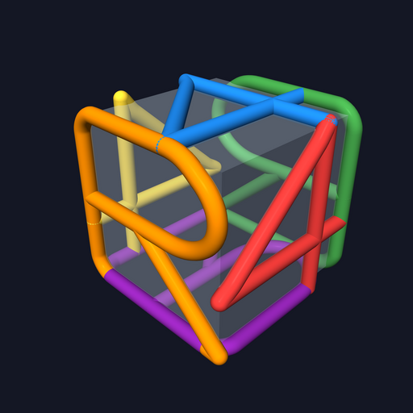

# R4nkine

<p align="center"></p>

A 3D rendering library in the spirit of IRIS Performer, for today's GPUs:
a scene graph built for speed, loaders for old and new asset formats, and
`r4fly`, a viewer that is the heir of perfly.

The name comes from the Rankine scale, the absolute version of the
Fahrenheit scale. Fahrenheit was the scene graph SGI, Microsoft and HP
announced in 1997 and never shipped. R4nkine is a homage to the OpenGL demos
of that era. The design is in [docs/DESIGN.md](docs/DESIGN.md).

## What is there

- `r4::gpu`: a backend interface modeled on the explicit APIs, with an
  **OpenGL 3.3** backend. The backend loads its functions at run time and
  works in core or compatibility contexts. It caches state and can save and
  restore the GL state of a host program.
- `r4::assets`: one neutral model format, and loaders for the formats of
  the SGI demos and their era:

  | Format | Files | From |
  | --- | --- | --- |
  | Wavefront OBJ/MTL | `.obj` | the smooth demos, everything else |
  | libgobj | `.d` | the flight simulator (state bits, transforms, lit and colored sections) |
  | YAODL | `.ydl`, `.defs` | powerflip and flip (polygons, NURBS, textures, sphere maps) |
  | flip objects | `.bin` | flip |
  | IRIS Performer | `.pfb` | Mekton, perfly; versions 1 and 2 (scrambled coordinates) |
  | Designer's Workbench | `.dwb` | the F-18 demo (encrypted textures) |
  | OpenFlight | `.flt` | 11, 12 and 14.2: palettes, subfaces, LOD, external references, `.attr` |
  | line drawings | `.gset` | the head-up display of Mekton |
  | glTF 2.0 | `.gltf`, `.glb` | today's assets (cgltf) |

  The image formats are **SGI** (`.rgb`, `.rgba`, `.bw`, `.int`, `.inta`; RLE
  or verbatim, 8 or 16 bits), **PPM/PGM**, the scrambled **5551E**
  images of perfly.face, and **PNG, JPEG, BMP, TGA, GIF** (stb_image). Textures and external references are searched next
  to the model and in the search paths (`addSearchPath`, `-F` in r4fly).
  `r4/assets/upscale.h` enlarges the small textures of the old games once, at
  load: **2xSaI**, **xBR 2x** and **xBR 4x** (the alpha counts as a color, the
  clear holes keep their sharp edges). The renderer adds **anisotropic
  filtering** (`RenderOptions::anisotropy`, when the GPU has it).
- `r4::scene`: Group, Geode, Switch, LOD, **Billboard** (axis or point) and
  **Instancer** nodes. An Instancer draws the same geometry at many places
  (forests, villages), culls each instance and picks its level of detail by
  distance. `collectParts` turns any loaded model into instancer parts.
  Its instances are matrices, or compact **placements** (position, heading
  about its up axis, scales: 24 bytes instead of 64) for millions of objects
  standing on the ground.
  Bounding spheres are kept up to date lazily, so the graph can change at
  run time.
- `r4::render`: culling of whole subtrees, a draw list sorted by state,
  and **GPU instancing**: the model matrices go in a per-instance vertex
  stream, and consecutive items with the same mesh, material and pipeline
  are one draw call. Shading is per-pixel Blinn-Phong with fog. Triangles,
  lines and points are drawn; decals and sphere maps are supported.
- `r4::raster`: 2D drawing on the CPU, as the old games drew their
  cockpits: surfaces of any size, in **8-bit indexed** pixels with a palette
  or in **RGBA** true colors (blended); pixels, lines (thick, dashed),
  rectangles, circles, ellipses, polygons, blits (transparent index, color
  offset, scaled), scrolling, clipping, bitmap text (fonts of 11 to 32
  pixels, and enlarged), and the palette effects (fade, blend, tint,
  brightness and contrast, cycling).
- `r4::render::Overlay`: a raster surface on the GPU, over the scene or as
  the texture of a mesh (a screen of a virtual cockpit). An indexed surface
  goes up as bytes and its palette as 256 colors, looked up in the shader:
  a new palette costs one small upload.
- `r4::render::PostProcess`: effects on the whole frame, the scene drawn
  into a target first: **MSAA**, **FXAA**, big pixels, colors (brightness,
  contrast, saturation, gamma, tint, fade), the frame **reduced to a
  palette** (VGA 256, EGA 16, CGA 4, handheld 4, amber; ordered
  dithering), and a **CRT** (scanlines, curvature, aberration, vignette).
- `r4::ui`: a small GUI in the look of the panels of IRIS Performer (the
  GUI of perfly): grey buttons in relief, switches with yellow lights, blue
  sliders, menu buttons, radio buttons, messages in yellow on dark boxes,
  plus folding sections, trees, tables, curves and a color picker (a
  square of saturation and value, a bar of hue, the R G B values). It is immediate (each
  frame calls the widgets with its own variables) and draws through
  `r4::gpu`, so it needs no other library. Its text uses glyphs baked from
  Liberation Sans (SIL Open Font License, `src/ui/OFL.txt`).
- `r4fly`: the viewer, with its panels in `r4::ui`:
  - **mouse**: the left button turns the view as the trackball of perfly
    (across: yaw, up and down: pitch, in the axes of the screen; or a
    turntable about the vertical, never rolling), the wheel zooms, the
    right button moves the center with the mouse; over a panel, the wheel
    scrolls it;
  - **left panel**: the camera (field of view, yaw, pitch and roll,
    distance, clip planes, front/side/top views), the lighting (headlight or a sun,
    colors), the environment (background, fog), the rendering (filled or
    lines, textures, the state mask bit by bit), the culling (view frustum,
    freezing it to look at it from outside, LOD scale) and the
    optimisations (sorting by state, instancing, vertical sync);
  - **show tree**: the graph drawn over the view as perfly did, boxes
    and links level by level, with its pans, scale and depth; a click
    selects a node;
  - **scene graph**: the tree of the nodes with their types, a light to
    hide each node, and the selected node's mask, state filter, matrix,
    bounds (drawn in the view), drawables, switch value, LOD ranges,
    billboard mode and instancer levels;
  - **stats**: the frame rate, the curves of the frame, cull and draw times
    over the last 240 frames, and the counters of the renderer (draw calls,
    triangles, state changes, items per draw, nodes and instances culled).

  The scene is drawn between the panels, as the channel of perfly. A
  **Post Process** section holds the effects on the frame; `-post` gives
  them on the command line (`-post msaa4,fxaa,crt,pixel3,ega`).
  Keys: F1 shows or hides the GUI, `w` wireframe, `r` reset, `s` statistics.
  `-snap` saves a frame, `-nogui` starts without the GUI, `-view` places
  the eye, `-state` chooses the state bits of the models, `-F` gives the
  search paths, and `-forest N[,F]` plants N copies of the files with an
  Instancer (the first file near, the next ones beyond F, 2F...).

## Downloads

The **Release** workflow builds archives for Linux, Windows and macOS:
r4fly, the examples (below) and sample models (`samples/`):

- *Actions > Release > Run workflow*: the archives are attached to the run
  (Artifacts); check *publish* to also make a GitHub release (a prerelease
  `dev-N`, or the tag given);
- pushing a tag `v*` publishes the release of that tag;
- a commit whose message holds `[release]` builds the archives once pushed.

The workflows run only when asked, to spare the minutes of Actions: a push
skips their jobs unless its last commit says `[ci]` (CI), `[release]`
(Release) or `[viewer]` (libRealSpace viewer). The *Run workflow* button of
each one appears once the workflow files are on `main`.

On macOS (Apple silicon), the archive is not signed: after unpacking it,
`xattr -dr com.apple.quarantine r4fly-*` lets it start. On Windows,
`r4fly.exe`, the examples and `SDL2.dll` are side by side: drop a model on
the exe, or run `r4fly samples\quad.obj`.

### libRealSpace: r4objviewer

The code that connects
[libRealSpace](https://github.com/remileonard/libRealSpace) to R4nkine is in
libRealSpace, on its `r4nkine` branch: `r4bridge` (an `RSEntity` as an
`r4::assets::Model`), `r4game` (the game drawn by R4nkine), `r4objviewer` (a
viewer of the 3D objects of the game) and `neosc_r4`. Its README
(`README_R4NKINE.md`, in French) is there too.

The **libRealSpace viewer** workflow (on demand, or `[viewer]` in a commit
message) builds `r4objviewer.exe` for Windows:
it clones libRealSpace (its `r4nkine` branch by default), builds it against
this R4nkine and attaches the exe and its DLLs to the run (Artifacts). The game data are not
in it: `r4objviewer -data <the folder of the TRE files>`.

## Platforms

Linux, Windows and macOS. On macOS, OpenGL stops at 4.1 in a core context:
the backend and the shaders are written for a core context, and r4fly asks
for one there (`-core` does the same elsewhere). The GUI follows Retina
screens: it is laid out in points and its text uses glyphs baked at twice
the size (`-scale S` enlarges it on the other screens).

## Building

The dependencies are managed by [vcpkg](https://vcpkg.io) in manifest
mode (`vcpkg.json`):

| Dependency | For | Feature |
| --- | --- | --- |
| glm | the vectors and matrices (`r4::Vec3` is `glm::vec3`, `r4::Mat4` is `glm::mat4`) | always |
| stb | the PNG, JPEG, BMP, TGA and GIF images | always |
| cgltf | glTF 2.0 | always |
| SDL2 | r4fly, the viewer | `viewer` (default) |
| OpenXR loader | `r4nkine_xr`, virtual reality (`r4/xr/xr.h`) | `xr` (default on Windows) |

With `VCPKG_ROOT` set to a vcpkg folder, the presets of `CMakePresets.json`
use its toolchain, and vcpkg installs the dependencies at configure time:

```
cmake --preset linux          # or windows (VS 2022), windows-vs (the newest VS), macos, linux-debug
cmake --build --preset linux
ctest --preset linux
```

Without the viewer (and without SDL2), add `-DR4_BUILD_APPS=OFF`: the
`viewer` feature of the manifest is then left out.

```
out/build/linux/r4fly model.obj other.obj
out/build/linux/r4fly -F pftown:pftexture:pfmodel pftown/town.flt
```

## Examples

The `examples` folder holds small programs, built with r4fly and shipped
in the archives. They make their meshes in code, so they need no file, and
each has a panel of `r4::ui` to play with it (the camera: yaw, pitch, roll
and distance in all of them):

| Example | What it shows |
| --- | --- |
| `hello_model [file]` | the smallest program: a model (any format) or a box, in a window; wireframe, textures, light and background colors |
| `forest` | an Instancer: up to 50000 trees, two levels of detail, a few draw calls; the panel changes the count, the LOD scale, instancing, culling and fog, and shows the cost |
| `hierarchy` | a plane and its missiles: matrices down the graph, a Switch (the gear, `G`), a LOD, missiles fired off their pylons (`Space`, `R` reloads); the panel flies the plane |
| `ui_panel` | `r4::ui`: a panel of perfly driving a box, with the color picker |
| `cockpit` | `r4::raster`: a cockpit drawn on the CPU (radar, horizon, compass tape, readouts) over the scene, in 320x200 indexed pixels or up to 1280x800 in true colors; palette effects; a HUD in true colors at the size of the window; the radar as a screen standing in the scene; the post process on everything |

`examples/common` holds what they share and is not R4nkine: an SDL2
window with its OpenGL context, and a few meshes made in code.

### A model in a window

```cpp
#include "r4/assets/model.h"
#include "r4/render/renderer.h"

auto device = r4::gpu::createGLDevice(SDL_GL_GetProcAddress);
r4::render::Renderer renderer(*device);

auto root = r4::scene::make<r4::scene::Group>();
auto model = r4::assets::loadModel("cow.obj");
root->addChild(renderer.upload(*model));

r4::render::Camera camera;
camera.lookAt({0, -5, 2}, {0, 0, 0});
camera.perspective(45, 16.0f / 9, 0.1f, 100);
renderer.render(*root, camera, 0, 0, width, height);
```

### Planting a forest

```cpp
auto tree = renderer.upload(*r4::assets::loadModel("tree.glb"));
auto far  = renderer.upload(*r4::assets::loadModel("tree_card.obj"));
auto forest = r4::scene::make<r4::scene::Instancer>();
forest->addLevel(r4::scene::collectParts(*tree), 150);  // up to 150 m
forest->addLevel(r4::scene::collectParts(*far), 2000);  // then up to 2 km
for (const r4::Mat4 &m : placements)
    forest->addInstance(m);
root->addChild(forest);
```

### Missiles under a wing

```cpp
auto pylon = r4::scene::make<r4::scene::Group>();
pylon->setMatrix(r4::translate({2.4f, 0.3f, -0.35f}));  // under the right wing
plane->addChild(pylon);
pylon->addChild(missile);                              // follows the plane

// fired: it leaves the pylon for the world, where it was
r4::Mat4 world = plane->matrix() * pylon->matrix() * missile->matrix();
pylon->removeChild(missile.get());
missile->setMatrix(world);
root->addChild(missile);
```

### A panel of perfly

```cpp
r4::ui::Context gui(*device);
gui.beginFrame(width, height, input);
gui.beginPanel("settings", {0, 0, 260, (float)height}, "My program");
if (gui.button("Reset")) reset();
gui.toggle("Spin", spin);
gui.slider("Speed", speed, 0, 360, "%.0f deg/s");
gui.menu("Style", style, {"Filled", "Lines"});
gui.endPanel();
gui.endFrame();
renderer.render(*root, camera, 0, 0, width, height);
gui.render();  // over the scene
```

## License

MIT, see [LICENSE](LICENSE).
