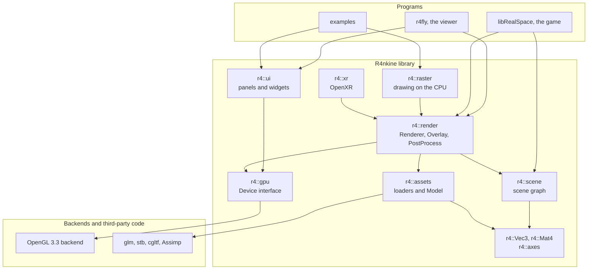
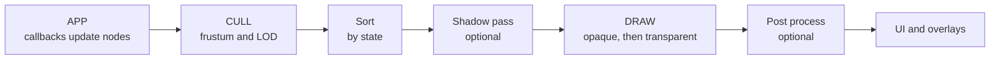
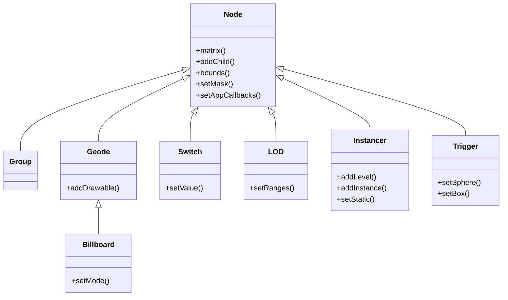
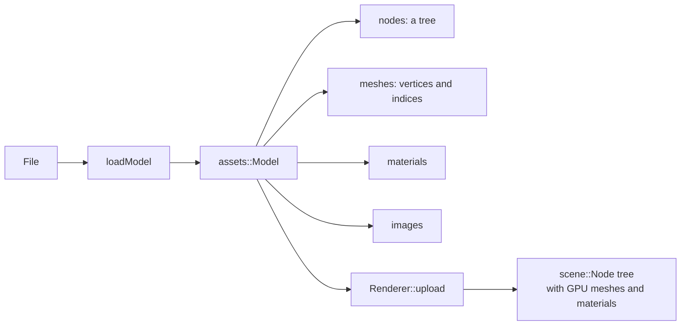

# R4nkine Programmer's Guide

This guide describes the R4nkine library. You can read it from the start to the end. You can also read one chapter when you need it.

The structure of this guide follows the structure of the IRIS Performer Programmer's Guide. Performer has a scene graph, traversals, callbacks, loaders, a graphics state and geometry. R4nkine has the same concepts. Some Performer chapters do not apply to R4nkine. These chapters are not in this guide.

This guide is written in Simplified Technical English (ASD-STE100).

## Contents

- [About this guide](#about-this-guide)
- Part I: Introduction
  - [1. Introduction to R4nkine](#1-introduction-to-r4nkine)
  - [2. System architecture](#2-system-architecture)
  - [3. Getting started](#3-getting-started)
- Part II: The scene graph
  - [4. The scene graph](#4-the-scene-graph)
  - [5. Traversals and callbacks](#5-traversals-and-callbacks)
  - [6. Frame rate and level of detail](#6-frame-rate-and-level-of-detail)
- Part III: Assets and rendering
  - [7. Loaders and assets](#7-loaders-and-assets)
  - [8. Rendering and the graphics state](#8-rendering-and-the-graphics-state)
  - [9. The GPU layer](#9-the-gpu-layer)
  - [10. Overlays and post process](#10-overlays-and-post-process)
- Part IV: Other libraries
  - [11. The raster library](#11-the-raster-library)
  - [12. The user interface](#12-the-user-interface)
  - [13. Navigation with the orbit camera](#13-navigation-with-the-orbit-camera)
  - [14. Virtual reality](#14-virtual-reality)
- Part V: Tools and examples
  - [15. The viewer r4fly](#15-the-viewer-r4fly)
  - [16. Examples](#16-examples)
  - [17. Coding rules](#17-coding-rules)
- [Appendix A: Glossary](#appendix-a-glossary)

---

## About this guide

This guide uses these rules:

- A word in `code font` is a name in the source code.
- A code example uses the names in the headers that it lists.
- "Must" marks a requirement. "Should" marks a recommendation. "Can" marks an option.
- Distances are in meters. Angles are in degrees, unless the text says radians.

---

## 1. Introduction to R4nkine

R4nkine is a 3D rendering library. It is written in C++17. The library has the same parts as IRIS Performer. It has a scene graph, loaders, a renderer, a 2D raster library and a user interface library.

R4nkine also has a viewer, named r4fly. You use r4fly to open and inspect models. You can also use r4fly to test the features of the library.

The library has one graphics backend. The backend uses OpenGL 3.3. The backend is in the namespace `r4::gpu`. You can write a backend for another graphics API.

### 1.1 Purpose

Use R4nkine to draw a scene in real time. A scene can have many models, many textures and many moving parts. R4nkine has these functions:

- It reads model files from many formats.
- It organizes the models in a scene graph.
- It culls the parts that the camera does not show.
- It draws the scene with a GPU.
- It draws pixels on the CPU when a program needs an old style of image.

### 1.2 Related documents

Other documents explain the design and the use of R4nkine in a game:

- [DESIGN.md](DESIGN.md) explains the design decisions.
- [GAME_INTEGRATION.md](GAME_INTEGRATION.md) explains how libRealSpace uses R4nkine.
- [AUDIO.md](AUDIO.md) explains the audio part of the game.
- [CODING_RULES.md](CODING_RULES.md) lists the rules for the code.

---

## 2. System architecture

This chapter describes how the parts of R4nkine work together. Each part has one task. A part uses only the parts below it.

### 2.1 Layers

The library has layers. The lowest layer does the math. The highest layer is the program that uses the library.



The assets layer reads files. It does not use the GPU. The scene layer organizes nodes. It does not use the GPU. The GPU layer is the only layer that calls the graphics API.

### 2.2 Frame flow

The program draws one frame in steps. The renderer does most of the steps in the function `Renderer::render`.



The steps are:

1. The program runs the APP traversal. The callbacks change the nodes.
2. The program calls `Renderer::render`.
3. The renderer culls the graph for the camera.
4. The renderer sorts the draw items. Opaque items are sorted by state. Transparent items are sorted from back to front.
5. The renderer draws the shadow map. This step runs only when shadows are on.
6. The renderer draws the opaque items. Then it draws the transparent items.
7. The program applies the post process. Then it draws the user interface.

### 2.3 Namespaces

All parts of the library are in the namespace `r4`. Each part has its own namespace.

| Namespace | Main types |
| --- | --- |
| `r4` | `Vec3`, `Mat4`, `translate` |
| `r4::axes` | Axis vectors and conversions of the axes |
| `r4::assets` | `Model`, `Mesh`, `Material`, `Image`, `loadModel` |
| `r4::scene` | `Node`, `Group`, `Geode`, `Switch`, `LOD`, `Billboard`, `Instancer`, `Trigger` |
| `r4::render` | `Renderer`, `Camera`, `Environment`, `RenderOptions`, `Overlay`, `PostProcess`, `Orbit` |
| `r4::gpu` | `Device`, `createGLDevice` |
| `r4::raster` | `Surface`, `Palette`, `Font` |
| `r4::ui` | `Context`, `Input`, `Rect` |
| `r4::xr` | `Session`, `Settings` |

### 2.4 Axes and units

R4nkine uses the axes of IRIS Performer and OpenFlight:

- X points to the right.
- Y points forward.
- Z points up.
- The unit of length is the meter.

Some file formats use Y-up axes. These formats are OBJ, glTF and OpenXR. The loaders turn the root of these models one time. Use `r4::axes::fromYUpMatrix()` to turn your own data.

```cpp
#include "r4/axes.h"

r4::Vec3 zUp = r4::axes::fromYUp({1, 2, 3}); // {1, -3, 2}
float height = r4::axes::heightOf(zUp);
```

---

## 3. Getting started

This chapter shows how to build R4nkine. It also shows a small program.

### 3.1 Requirements

Use vcpkg in manifest mode. The file `vcpkg.json` lists the dependencies. These dependencies are used:

| Dependency | Use | Feature |
| --- | --- | --- |
| glm | Vectors and matrices | Always used |
| stb | PNG, JPEG, BMP, TGA and GIF images | Always used |
| cgltf | glTF 2.0 files | Always used |
| SDL2 | The viewer and the examples | `viewer` |
| Assimp | Other model formats | `assimp` |
| OpenXR loader | Virtual reality | `xr` |

### 3.2 Build

Set the variable `VCPKG_ROOT` to the folder of vcpkg. Then run these commands:

```
cmake --preset linux
cmake --build --preset linux
ctest --preset linux
```

The viewer `r4fly` is in the folder `out/build/linux/`.

To build only the library, turn off the applications:

```
cmake --preset linux -DR4_BUILD_APPS=OFF
```

### 3.3 Your first program

This program shows one model in a window. It uses SDL2 for the window. The file `examples/hello_model.cpp` has the full program.

```cpp
#include "r4/assets/model.h"
#include "r4/render/renderer.h"

std::string error;
auto device = r4::gpu::createGLDevice(SDL_GL_GetProcAddress, &error);
r4::render::Renderer renderer(*device);

auto model = r4::assets::loadModel("cow.obj", &error);
auto root = r4::scene::make<r4::scene::Group>();
root->addChild(renderer.upload(*model));

r4::render::Camera camera;
camera.lookAt({0, -5, 2}, {0, 0, 0});
camera.perspective(45, 16.0f / 9, 0.1f, 100);
renderer.render(*root, camera, 0, 0, width, height);
```

The program does these steps:

1. It creates a GPU device for the OpenGL context of the window.
2. It creates a renderer for the device.
3. It loads a model from a file.
4. It uploads the model. The upload returns a node. The program adds the node to the graph.
5. It sets the camera.
6. It renders the graph into the viewport.

---

## 4. The scene graph

The scene graph is the main structure of R4nkine. It is a set of nodes. Each node has a parent and children. The parent places its children in its own space.

This chapter describes the node types and the rules of the graph. Then it describes each special node.

### 4.1 Nodes and the graph

Each node has a type. The type decides how the renderer uses the node.



| Node | Type | Purpose |
| --- | --- | --- |
| `Group` | `NodeType::GROUP` | Holds children. |
| `Geode` | `NodeType::GEODE` | Holds drawables. A drawable is a mesh with a material. |
| `Switch` | `NodeType::SWITCH` | Draws one child, all children or no child. |
| `LOD` | `NodeType::LOD` | Draws one child for each distance from the eye. |
| `Billboard` | `NodeType::BILLBOARD` | Turns to face the eye. |
| `Instancer` | `NodeType::INSTANCER` | Draws many copies of the same geometry. |
| `Trigger` | `NodeType::TRIGGER` | Sends events when a tracked point enters or leaves a volume. It is not drawn. |

Create a node with `r4::scene::make`:

```cpp
auto base = r4::scene::make<r4::scene::Group>();
base->setName("base");
```

A node can have only one parent in your program. Do not add a node to itself, directly or through its children. The graph must not have cycles.

### 4.2 Hierarchy and transformations

Use `addChild` and `removeChild` to change the hierarchy:

```cpp
parent->addChild(child);
parent->removeChild(child.get());
```

The matrix of a node places the node in its parent. The world matrix is the product of the matrices from the root to the node. The program sets a matrix with `setMatrix`.

```cpp
r4::Mat4 world = plane->matrix() * pylon->matrix() * missile->matrix();
```

Use `r4::translate` to make a translation matrix. This matrix moves a node by a vector.

```cpp
gear->setMatrix(r4::translate({0, 0, -1.5f}));
```

### 4.3 Groups and geodes

A `Group` holds children only. It does not draw anything. Use a group to organize the graph.

A `Geode` holds drawables. Each drawable has a mesh and a material. The renderer draws the drawables of each geode.

```cpp
auto geode = r4::scene::make<r4::scene::Geode>();
geode->addDrawable({mesh, material});
geode->clearDrawables();
```

The renderer does not draw groups. It draws the geodes below the groups.

### 4.4 Switches

A `Switch` shows one child at a time. The value of the switch is the index of the child. Two special values have a meaning:

- `Switch::kAll` shows all children.
- `Switch::kNone` shows no child.

Use a switch for parts that change state. A landing gear is an example.

```cpp
auto gear = r4::scene::make<r4::scene::Switch>();
gear->addChild(gearUp);
gear->addChild(gearDown);
gear->setValue(1);                         // shows gearDown
gear->setValue(r4::scene::Switch::kNone);  // shows no child
```

### 4.5 Level of detail

A `LOD` node chooses one child for each distance from the eye. A detailed child is for near objects. A basic child is for far objects.

The `LOD` has one range more than it has children. The ranges are the limits of the distances. The first range starts at zero.

```cpp
auto lod = r4::scene::make<r4::scene::LOD>();
lod->addChild(detailed);  // from 0 m to 150 m
lod->addChild(simple);    // from 150 m to 2000 m
lod->setRanges({0, 150, 2000});
```

The distance is measured to the center of the bounds of the node. To use another center, call `setCenter`. The option `lodScale` in the render options multiplies all distances. Chapter 6 describes the option.

### 4.6 Billboards

A `Billboard` turns its geometry to face the eye. Use a billboard for objects that are flat and must face the viewer. Trees, signs and smoke are examples.

The mode of the billboard sets the axis of the turn. Use `Billboard::Mode::Axis` when the object must stay upright. Use `Billboard::Mode::Point` when the object must face the eye in all directions.

```cpp
auto tree = r4::scene::make<r4::scene::Billboard>();
tree->setMode(r4::scene::Billboard::Mode::Axis);
tree->addDrawable({mesh, material});
```

### 4.7 Instancers

An `Instancer` draws the same geometry at many places. Use an instancer for a forest or a village. An instancer draws many copies with few draw calls.

An instancer has levels. Each level has a maximum distance. The first level is the nearest. The last level is the farthest.

```cpp
auto tree = renderer.upload(*r4::assets::loadModel("tree.glb"));
auto card = renderer.upload(*r4::assets::loadModel("tree_card.obj"));

auto forest = r4::scene::make<r4::scene::Instancer>();
forest->addLevel(r4::scene::collectParts(*tree), 150);   // up to 150 m
forest->addLevel(r4::scene::collectParts(*card), 2000);  // up to 2000 m

for (const r4::Mat4 &m : matrices) {
    forest->addInstance(m);
}
root->addChild(forest);
```

An instancer has two ways to place its copies:

- Matrices. The method `addInstance` takes one full matrix for each copy. Use this way for a few objects.
- Placements. The method `setPlacements` takes a list of `Placement` values. A placement has a position, a heading, a scale and a vertical scale. The heading is in radians. A placement uses 24 bytes. A matrix uses 64 bytes. Use placements for many objects on the ground.

```cpp
forest->setPlacements({
    {{100, 200, 0}, 0.5f, 1.0f, 1.0f},
});
```

When the placements do not change, call `setStatic`. The renderer then sends the placements to the GPU one time. The value in the call is the distance from which the instancer draws fewer copies.

```cpp
forest->setStatic(500);  // draws fewer copies beyond 500 m
```

### 4.8 Masks

A mask is a set of bits. Each node has a mask. Each camera has a mask. The renderer skips a node when the mask of the node and the mask of the camera have no bit in common.

```cpp
hidden->setMask(0);            // the node is never drawn
cloud->setMask(LAYER_CLOUDS);  // drawn by the cameras with this bit
```

Use masks to choose what each camera sees. For example, a cockpit camera does not draw the outside objects. The renderer uses the same rule for the shadow map. The render option `shadowMask` selects the casters.

### 4.9 Bounding volumes

Each node has a bounding sphere. Call `bounds()` to get the sphere. The sphere is in the space of the node. The sphere covers the node and all its children.

```cpp
const r4::Sphere &s = node->bounds();
```

The renderer uses the bounds for culling. It uses the bounds for the level of detail. The library computes the bounds again when the graph changes. The program does not need to call an update function.

---

## 5. Traversals and callbacks

A traversal walks through the scene graph. Each traversal does one task. Performer has four traversals. R4nkine has three traversals that work now. The fourth traversal is planned.

| Traversal | Who starts it | Task | Status |
| --- | --- | --- | --- |
| APP | The program, one time for each simulation step | Runs the callbacks. Sets positions. Checks triggers. | Available |
| CULL | The renderer, for each camera | Finds the nodes that a camera shows. | Available |
| DRAW | The renderer | Draws the nodes. | Available |
| ISECT | A query of the program | Finds the intersections of segments and rays. | Not yet available |

### 5.1 The application traversal

The application traversal, named APP, runs the callbacks. A callback is a function that changes a node. The program uses callbacks to move parts of the scene. The callbacks run before the frame is drawn.

Each node has two callbacks:

- The callback `before` runs before the children of the node.
- The callback `after` runs after the children of the node.

Set the callbacks with `setAppCallbacks`. Call `r4::scene::app` to run the traversal.

```cpp
auto plane = r4::scene::make<r4::scene::Group>();
plane->setAppCallbacks([&](r4::scene::Node &node) {
    node.setMatrix(state.planeMatrix());
});

r4::scene::app(*root);
renderer.render(*root, camera, 0, 0, width, height);
```

The APP mask selects the nodes that run their callbacks. A node is skipped when the bit of the APP mask is not in the mask of the node. The callbacks of a skipped node do not run. The children of a skipped node are skipped too.

```cpp
decor->setAppMask(0);  // the callbacks of decor do not run
```

The APP traversal does not use the mask of the camera. A node that the renderer does not draw can still change in the APP traversal.

### 5.2 Culling and drawing

The renderer does the CULL and DRAW traversals. The program does not call these traversals. The renderer runs them in `Renderer::render`.

The CULL traversal does these checks for each node:

1. It skips a node when the mask of the node does not match the mask of the camera.
2. It skips a node when its bounds are outside the view frustum.
3. It chooses one child of a `Switch`, a `LOD` or an instancer level.
4. It adds the drawables of the visible geodes to the draw list.

The DRAW traversal draws the items of the draw list. It uses the sort order that the renderer chose.

Use the render options to change the culling:

```cpp
auto &options = renderer.options();
options.frustumCulling = false;  // draw everything
options.freezeCulling = true;    // keep the view of this moment
```

When `freezeCulling` is on, the renderer keeps the eye and the frustum of the frame when the option was set. You can move the camera. The camera then shows what the renderer culled. This method helps you check the culling.

### 5.3 The intersection traversal

The intersection traversal, named ISECT, finds the intersections of segments and rays with the graph. Performer uses this traversal to test for collisions and for the ground height.

R4nkine does not have this traversal yet. The planned design is in [GAME_INTEGRATION.md](GAME_INTEGRATION.md). Until then, the game uses its own ground height check.

### 5.4 Trigger volumes

A `Trigger` is a node with a volume. The volume can be a sphere, a cylinder or a box. The volume is in the space of the trigger. Z points up.

A tracker is a point with an identifier. The program gives the trackers to the function `checkTriggers`. The function calls `onEnter` when a tracker enters a volume. It calls `onLeave` when a tracker leaves a volume.

```cpp
auto area = r4::scene::make<r4::scene::Trigger>();
area->setSphere(5000);
area->setMatrix(r4::translate({12000, 4000, 0}));
area->onEnter = [](uint32_t id) { startMission(id); };
area->onLeave = [](uint32_t id) { stopMission(id); };
root->addChild(area);

std::vector<r4::scene::Tracker> trackers = {{playerId, playerPosition}};
r4::scene::checkTriggers(*root, trackers);
```

Call `checkTriggers` in the APP step. The events depend on the positions of the trackers, not on the frame rate.

---

## 6. Frame rate and level of detail

A program must draw each frame in a fixed time. This chapter describes the tools that help you control the frame time. These tools are culling, level of detail, instancing and the statistics.

### 6.1 Why the frame time changes

The frame time depends on the number of items that the GPU draws. Each draw call has a cost on the CPU. Each triangle has a cost on the GPU. A scene with many small objects has many draw calls. A scene with a large object close to the eye has many triangles.

The tools in this chapter reduce both costs. They do not change the look of the scene when they are set well.

### 6.2 Culling

Culling removes the objects that the camera does not show. The renderer culls the nodes outside the frustum. The renderer also culls the instances of an instancer that are outside the frustum.

Culling is on by default. Turn it off only to test a scene. Turn it on again before you measure the frame time.

### 6.3 Level of detail

The level of detail gives a model with fewer details for a far object. Use a `LOD` node for one object. Use the levels of an `Instancer` for many objects.

The render option `lodScale` changes all distances at the same time. A value above 1 uses the detailed models for longer. A value below 1 uses the models with fewer details sooner.

```cpp
renderer.options().lodScale = 0.5f;  // switch to the simple models at half the distance
```

### 6.4 Statistics

The renderer counts the work of each frame. The method `stats` returns the counters of the last frame. Use the counters to find the cause of a slow frame.

```cpp
const auto &stats = renderer.stats();
printf("nodes visited: %u, culled: %u\n", stats.nodesVisited, stats.nodesCulled);
printf("opaque items: %u, transparent items: %u\n", stats.opaqueItems, stats.transparentItems);
printf("cull: %.2f ms, draw: %.2f ms\n", stats.cullMs, stats.drawMs);
```

The times are CPU times, in milliseconds. The field `gpu` has the counters of the GPU.

---

## 7. Loaders and assets

A loader reads a file. The loader makes an `assets::Model`. The model is a description of the file. It does not use the GPU. The renderer uploads the model to the GPU later.

This chapter describes the model, the loaders and the search paths.

### 7.1 The model

A `Model` has four parts:



- The nodes form a tree. The first node is the root.
- The meshes hold the vertices and the indices. All meshes use the same vertex format.
- The materials hold the colors, the shading and the alpha mode.
- The images hold the textures.

Each node refers to meshes by index. Each mesh refers to a material by index. The index is `-1` when the mesh has no material.

### 7.2 Loading a model

Call `loadModel`. The function chooses the loader from the extension of the file. The function returns a shared pointer to the model.

```cpp
std::string error;
auto model = r4::assets::loadModel("town/house.flt", &error);
if (!model) {
    std::cerr << error << "\n";
}
```

When the file cannot be read, the function returns `nullptr`. The function sets `error` to the reason. To list the extensions that the library reads, call `r4::assets::modelExtensions()`.

### 7.3 Supported formats

R4nkine has loaders for these formats:

| Format | Extensions | Loader |
| --- | --- | --- |
| Wavefront OBJ with MTL | `.obj` | `loadOBJ` |
| libgobj, from the SGI flight simulator | `.d` | `loadGObj` |
| YAODL, from powerflip and flip | `.ydl`, `.defs` | `loadYAODL` |
| flip objects | `.bin` | `loadFlipBin` |
| IRIS Performer, versions 1 and 2 | `.pfb` | `loadPFB` |
| Designer's Workbench | `.dwb` | `loadDWB` |
| OpenFlight, versions 11, 12 and 14.2 | `.flt` | `loadFLT` |
| Line drawings | `.gset` | `loadGSet` |
| glTF 2.0 | `.gltf`, `.glb` | `loadGLTF` |

Other formats use Assimp. Build with the option `R4_WITH_ASSIMP` to read them. Examples are FBX, COLLADA, 3DS, PLY and STL.

An OpenFlight file can refer to other files. The loader finds these files with the search paths. Chapter 7.5 describes the search paths.

The glTF loader changes the PBR materials to the materials of R4nkine:

- The base color gives the diffuse color. The metallic and roughness factors give `Material::metallic` and `Material::roughness`, the specular color and the shininess.
- A material with `roughness` >= 0 reflects the environment of the renderer (`Environment::envSky`, `envHorizon`, `envGround`): a sky over the horizon and a ground under it, blurred by the roughness, more at a grazing angle (Fresnel). A metal (`metallic` 1) has no diffuse light: its color is its reflection and its highlight. The other loaders give `roughness` -1: Phong only.
- The emissive texture multiplies the emissive color (`Material::emissiveImage`).
- The normal map bends the normal (`Material::normalImage`, `normalScale`). The tangent space comes from the derivatives of the position and of the texture coordinates in the fragment shader: the vertices need no tangent. `tests/data/bump.gltf` shows a mapped quad beside a real hemisphere.
- `KHR_texture_transform` of the base color texture (offset, rotation, scale) changes the texture coordinates of the mesh; without a base color texture, the one of the normal map.
- `alphaMode` gives the alpha mode: `BLEND` or `MASK` with its cutoff.
- `KHR_materials_transmission` (glass) gives a blended material: a fully transmissive material lets 85 % of the light through. There is no refraction.
- `KHR_materials_emissive_strength` multiplies the emissive color.
- `KHR_materials_unlit` gives an unlit material.
- Not read: the occlusion and metallic-roughness textures, the clearcoat, the iridescence, the variants (the default material is used).

### 7.4 Images

An `Image` is a set of pixels in memory. Each pixel has one byte for each channel. The first row is at the bottom of the image.

| Channels | Content |
| --- | --- |
| 1 | Grey |
| 2 | Grey and alpha |
| 3 | Red, green and blue |
| 4 | Red, green, blue and alpha |

Use `loadImage` to read an image from a file:

```cpp
r4::assets::Image image;
std::string error;
if (r4::assets::loadImage("wall.png", image, &error)) {
    int texels = image.width * image.height;
}
```

The library reads these image formats: SGI, PPM, PGM, PNG, JPEG, BMP, TGA and GIF. It also reads the scrambled 5551E images of perfly.

### 7.5 Search paths

A model can refer to other files. For example, a model refers to its textures. The library searches for these files in this order:

1. The folder of the model.
2. The folders next to it, named `../textures` and `textures`.
3. The search paths that the program adds.

Add a search path with `addSearchPath`:

```cpp
r4::assets::addSearchPath("C:/games/pftown");
```

Use `findAsset` to find a file in the search paths. The function returns the path of the file. When the file is not found, the function returns an empty string.

```cpp
std::string path = r4::assets::findAsset("models", "wall.rgb");
```

### 7.6 Texture upscaling

The header `r4/assets/upscale.h` enlarges small textures. The enlargement is done one time, when the texture is loaded. The library has these methods:

- `Upscale::SAI_2X`, the 2xSaI method.
- `Upscale::XBR_2X`, the xBR method with a factor of 2.
- `Upscale::XBR_4X`, the xBR method with a factor of 4.

These methods keep sharp edges in pixel art. The method treats the alpha channel as a color.

```cpp
r4::assets::Image big = r4::assets::upscale(image, r4::assets::Upscale::XBR_2X);
```

---

## 8. Rendering and the graphics state

The renderer draws the scene graph on the GPU. This chapter describes the renderer. It also describes the cameras, the environment, the options, the sorting and the shadows.

In Performer, the graphics state is a set of values that the GPU uses for a draw. In R4nkine, the graphics state is in the pipeline and in the materials. The renderer sets the state for each item.

### 8.1 The renderer

Create one renderer for each GPU device. The renderer keeps the uploaded resources.

```cpp
r4::render::Renderer renderer(*device);
```

Call `upload` to send a model to the GPU. The function returns a node. Add the node to the graph.

```cpp
auto node = renderer.upload(*model);
root->addChild(node);
```

To upload only a part of a model, use these methods:

- `uploadMesh` uploads one mesh.
- `uploadImage` uploads one image and returns a texture handle.
- `createMaterial` creates a material from an `assets::Material`.

```cpp
auto texture = renderer.uploadImage(image);
auto material = renderer.createMaterial(assetMaterial, texture);
```

### 8.2 Cameras

A `Camera` has a position, a view matrix, a projection matrix and a mask. The methods `lookAt` and `perspective` set the matrices.

```cpp
r4::render::Camera camera;
camera.lookAt({0, -10, 5}, {0, 0, 0});    // eye, then the center
camera.perspective(60, 4.0f / 3, 0.5f, 5000);
camera.mask = LAYER_OUTSIDE;              // only nodes with this bit
```

The method `lookAt` takes the eye, the center and an optional up vector. The default up vector is Z. The method `perspective` takes the field of view in degrees, the aspect ratio, and the near and far distances.

Call `render` to draw the scene into a viewport. The viewport is in pixels. The origin is at the bottom left of the window.

### 8.3 The environment

The `Environment` sets the light, the ambient color, the background and the fog. Each renderer has one environment.

```cpp
auto &env = renderer.environment();
env.lightDirection = {-0.4f, -0.3f, -0.85f};  // the direction in which the light goes
env.clearColor = {0.1f, 0.1f, 0.2f, 1};
env.fog = true;
env.fogStart = 500;
env.fogEnd = 3000;
```

Fog gets stronger between the start distance and the end distance.

### 8.4 Render options

Use `renderer.options()` to change the render options. Each option changes one part of the rendering. The most used options are:

| Option | Default | Effect |
| --- | --- | --- |
| `clear` | `true` | Clears the target before the frame. Set it to `false` to draw over an image of the host. |
| `frustumCulling` | `true` | Removes the nodes outside the view. |
| `freezeCulling` | `false` | Keeps the culling of the moment that the option was set. |
| `sortByState` | `true` | Sorts the opaque items by state. |
| `instancing` | `true` | Groups the same items into one draw call. |
| `textures` | `true` | Uses the textures. |
| `lighting` | `true` | Lights the surfaces. Set it to `false` for flat colors. |
| `flatShading` | `false` | Uses the normal of each face. |
| `lodScale` | `1` | Multiplies the distances of the LODs and the instancers. |
| `anisotropy` | `1` | Sets the anisotropic filter for the textures that are uploaded later. |
| `shadows` | `false` | Draws a shadow map. |

To draw the scene as lines, call `renderer.setWireframe(true)`.

### 8.5 Sorting and instancing

The renderer groups the draw items. It uses the sort order to reduce the changes of state on the GPU.

- The opaque items are sorted by state.
- The transparent items are sorted from back to front. A transparent item behind another item is drawn first.

Use `sortByState = false` to keep the order of the graph. Use `instancing = false` to make one draw call for each item. These options are useful for tests. The default values are the fastest.

### 8.6 Shadows

The renderer can draw a shadow map. The shadow map is an orthographic view from the light. The map covers the area up to `shadowDistance`.

```cpp
auto &options = renderer.options();
options.shadows = true;
options.shadowMapSize = 2048;
options.shadowDistance = 200;
options.shadowMask = LAYER_TERRAIN | LAYER_ACTORS;
```

Only the nodes with a bit in common with `shadowMask` cast shadows. The option `shadowStrength` sets how dark the shadow is. The option `shadowBias` avoids the shadow acne on flat surfaces.

### 8.7 Environment and frame statistics

The renderer keeps the counters of the last frame. Chapter 6.4 shows how to read them.

---

## 9. The GPU layer

The GPU layer is the only part of the library that calls the graphics API. The other parts use the interface `gpu::Device`. This design lets you use another graphics API. The renderer, the user interface and the post process use the interface.

### 9.1 The device

Create the OpenGL device for the current context:

```cpp
std::string error;
auto device = r4::gpu::createGLDevice(SDL_GL_GetProcAddress, &error);
if (!device) {
    std::cerr << error << "\n";
}
```

The function loads the OpenGL functions at run time. The function works in a core context and in a compatibility context.

### 9.2 Handles and resources

The device uses handles. A handle is an identifier for a resource. A handle with the value 0 is empty. These handles exist:

| Handle | Resource |
| --- | --- |
| `BufferHandle` | Vertex, index and uniform data |
| `TextureHandle` | An image on the GPU |
| `ShaderHandle` | A vertex or a fragment shader |
| `PipelineHandle` | A shader, a vertex layout and the states of a draw |
| `RenderTargetHandle` | An image that a pass draws into |

Create a texture with a descriptor:

```cpp
r4::gpu::TextureDesc desc;
desc.width = 256;
desc.height = 256;
desc.format = r4::gpu::TextureFormat::RGBA8;
desc.mipmaps = true;
auto texture = device->createTexture(desc, pixels);
```

Destroy a resource when the program does not use it. For example:

```cpp
device->destroyTexture(texture);
```

The states of a draw are in the pipeline. A pipeline sets the culling, the blend mode and the depth test. Create a pipeline one time. Bind it for each draw.

### 9.3 Passes

A pass draws into a target. When the target handle is empty, the pass draws into the window.

```cpp
r4::gpu::ClearValues clear;
clear.r = 0.1f;
device->beginPass(0, 0, width, height, clear);
device->bindPipeline(pipeline);
device->drawIndexed(indexCount);
device->endPass();
```

Use `createRenderTarget` to make a target. Then use the target in a pass. Each pass must end before the next pass starts.

### 9.4 Host interoperation

A host program can draw in the same OpenGL context. R4nkine saves the state of the host before it draws. R4nkine gives the state back after it draws.

```cpp
device->beginHostInterop();
// R4nkine draws here
device->endHostInterop();
```

When R4nkine is the only user of the context, turn this function off with `setHostInterop(false)`. The caches of the device then stay valid.

---

## 10. Overlays and post process

This chapter describes two ways to change the image after the scene is drawn. An overlay draws a 2D image over the scene. A post process changes the whole frame.

### 10.1 Overlays

An `Overlay` shows a raster surface on the GPU. Use an overlay to draw a cockpit over the scene. You can also use an overlay as the texture of a mesh, for example a screen in a cockpit.

```cpp
r4::render::Overlay overlay(*device);
overlay.update(screen, &palette);
overlay.opacity = 0.9f;
overlay.draw(0, 0, width, height, width, height);
```

An indexed surface is sent as bytes. Its palette is sent as 256 colors. The shader looks up the colors. A new palette costs one small upload. A surface is sent again only when it changed.

The method `texture` returns a texture of the surface. Use the texture on a mesh.

### 10.2 Post process

A `PostProcess` changes the whole frame. The renderer draws into a target first. The post process then draws the target into the window.

```cpp
r4::render::PostProcess post(*device);
post.settings.msaa = 4;
post.settings.fxaa = true;
post.settings.quantize = true;
post.settings.palette = r4::raster::Palette::vga();

auto target = post.begin(width, height);
renderer.setTarget(target);
renderer.render(*root, camera, 0, 0, width, height);
renderer.setTarget({});
post.end(0, 0, width, height, width, height);
```

The settings change these parts of the image:

| Effect | Settings |
| --- | --- |
| Antialiasing | `msaa` (1, 2, 4 or 8) and `fxaa` |
| Big pixels | `pixelate` |
| Colors | `brightness`, `contrast`, `saturation`, `gamma`, `fade` |
| Palette | `quantize`, `palette`, `paletteSize`, `dither` |
| CRT screen | `scanlines`, `curvature`, `aberration`, `vignette` |

When no effect is on, `begin` returns an empty handle. The renderer then draws into the window.

---

## 11. The raster library

The raster library draws pixels on the CPU. Early games drew their cockpits this way. The library is in the namespace `r4::raster`. It does not use the GPU. Use an overlay to show a raster surface on the GPU.

### 11.1 Surfaces

A `raster::Surface` is an image in memory. It has one of two formats:

| Format | Pixel | Use |
| --- | --- | --- |
| `Format::INDEXED8` | 8 bits. Each value is an index in a palette. | Old games and palette effects |
| `Format::RGBA8` | 32 bits. Red, green, blue and alpha. | True colors and blending |

```cpp
r4::raster::Surface screen(320, 200, r4::raster::Format::INDEXED8);
r4::raster::Surface hud(1280, 800, r4::raster::Format::RGBA8);
```

Use `setClip` to limit the drawing to a rectangle. Use `resetClip` to remove the limit. The first row of a surface is at the top.

### 11.2 Palettes

A `Palette` has 256 colors. Use a palette with an indexed surface.

```cpp
auto palette = r4::raster::Palette::vga();
int index = palette.nearest(255, 128, 0);
```

Some methods make a new palette and keep the old one. These methods are `fadedTo`, `blendedWith`, `adjusted`, `tinted` and `rotated`. The method `rotated` moves the colors between two indices by a number of steps. Use it for water and fire effects.

```cpp
palette = palette.rotated(16, 31, 1);  // one step of the water colors
```

### 11.3 Drawing

A surface has methods for drawing. The coordinates start at the top left.

```cpp
screen.clear(r4::raster::rgba(0, 0, 0));
screen.fillRect(10, 10, 100, 40, r4::raster::rgba(255, 200, 0));
screen.line(0, 0, 319, 199, r4::raster::rgba(255, 255, 255));
screen.fillCircle(160, 100, 30, 12);
screen.blit(sprite, 40, 60, 0, 0, 0, 0, 0, &palette);
```

The method `blit` copies a surface onto another surface. A pixel with the transparent index is not copied.

### 11.4 Text

Use a font to draw text. The function `Font::builtin` gives a built-in font. It takes the size in pixels.

```cpp
const auto &font = r4::raster::Font::builtin(16);
screen.text(font, 10, 10, "ALT 1500", r4::raster::rgba(255, 255, 0));
```

---

## 12. The user interface

The user interface library draws panels and widgets. It is an immediate mode library. Each frame, the program calls the widgets again with the current values. The library does not keep the widgets between frames.

The library draws through the interface `gpu::Device`. It does not need another library for the drawing. The text uses the Liberation Sans font. This font has the SIL Open Font License.

### 12.1 The frame

Each frame has four steps:

1. Call `beginFrame` with the size of the window and the input.
2. Call the panels and the widgets.
3. Call `endFrame`.
4. Call `render` to draw the panels over the scene.

```cpp
r4::ui::Context gui(*device);

gui.beginFrame(width, height, input);
// the panels and the widgets go here
gui.endFrame();
renderer.render(*root, camera, 0, 0, width, height);
gui.render();  // over the scene
```

Call `wantsMouse` to find out if the user interface uses the mouse. Call `wantsKeyboard` to find out if a text field has the focus. When the interface uses the mouse, do not use the mouse for the scene.

### 12.2 Panels and widgets

A panel is a column of widgets. It has a title. The wheel of the mouse scrolls the panel.

```cpp
gui.beginPanel("settings", {0, 0, 260, (float)height}, "My program");
if (gui.button("Reset")) {
    reset();
}
gui.toggle("Spin", spin);
gui.slider("Speed", speed, 0, 360, "%.0f deg/s");
gui.menu("Style", style, {"Filled", "Lines"});
gui.endPanel();
```

Each widget returns a value or changes a variable. These widgets exist:

| Widget | Function | Result |
| --- | --- | --- |
| Button | `button` | Returns `true` when the user clicks it |
| Switch | `toggle` | Changes a `bool` |
| Slider | `slider` | Changes a `float` in a range |
| Menu | `menu` | Changes an index in a list |
| Radio buttons | `radio` | Changes an index in a list |
| Text field | `inputText` | Changes a `std::string` |
| Color picker | `color` | Changes a `Vec3` |
| Section | `section` | Opens or closes a group of widgets |
| Table | `table` | Shows rows of text |
| Plot | `plot` | Shows values up to a maximum |
| Tree | `treeRow` | Shows one row of a graph |

Use `beginBox` and `endBox` to make an area with a frame and its own scroll bar.

### 12.3 Input

The structure `Input` has the state of the mouse and the keyboard. The program fills the structure each frame.

```cpp
r4::ui::Input input;
input.mouseX = x;     // points, from the top left
input.mouseY = y;
input.left = leftDown;
input.wheel = wheel;  // notches, positive away from the user
input.text = typed;   // UTF-8 text for a text field
```

The coordinates are in points. On a screen with high density, one point has more than one pixel. Pass the scale to `beginFrame`:

```cpp
gui.beginFrame(width, height, input, 2.0f);
```

---

## 13. Navigation with the orbit camera

The class `r4::render::Orbit` turns a camera around a point. The user moves the view with the mouse. The orbit uses the same method as the trackball of perfly.

```cpp
r4::render::Orbit orbit;
orbit.target = {0, 0, 0};
orbit.distance = 20;
orbit.turn(dx, dy);  // degrees, from the mouse
orbit.apply(camera, 45, aspect, 0.1f, 1000);
```

The method `turn` changes the heading and the pitch. The method `pan` moves the target. The method `angles` gives the heading, the pitch and the roll in degrees. The method `setAngles` sets them.

---

## 14. Virtual reality

The header `r4/xr/xr.h` supports virtual reality with OpenXR. The renderer draws the two eyes. The headset shows the images.

```cpp
std::string error;
auto xr = r4::xr::Session::create(*device, {}, &error);
while (xr->pollEvents()) {
    if (xr->beginFrame()) {
        for (int i = 0; i < xr->eyeCount(); i++) {
            renderer.setTarget(xr->eye(i).target);
            renderer.render(*root, xr->eye(i).camera, 0, 0, xr->eye(i).width, xr->eye(i).height);
        }
        renderer.setTarget({});
    }
    xr->endFrame();
}
```

The OpenGL binding works only on Windows. On other systems, `create` returns an error. Build the virtual reality part with the option `R4_BUILD_XR`.

---

## 15. The viewer r4fly

The viewer r4fly opens models and shows them. It has panels for the camera, the lighting, the rendering and the statistics. It is the main tool for tests. Use it to check a model before you use the model in a program.

### 15.1 Start

Start r4fly with one or more files. Each file is loaded under one root.

```
r4fly model.obj other.obj
r4fly -F pftown:pftexture:pfmodel pftown/town.flt
```

### 15.2 Mouse and keys

| Input | Action |
| --- | --- |
| Left button and move | Turns the view |
| Right button and move | Moves the center of the view |
| Wheel | Zooms |
| Wheel over a panel | Scrolls the panel |
| F1 | Shows or hides the user interface |
| `w` | Shows the scene as lines |
| `r` | Resets the view |
| `s` | Shows or hides the statistics |
| Escape | Quits |

### 15.3 Command line

These options are available:

| Option | Effect |
| --- | --- |
| `-size WxH` | Sets the size of the window in pixels |
| `-F paths` | Gives the search paths. Separate the paths with `:` |
| `-post effects` | Sets the post process. For example, `-post msaa4,fxaa,crt,pixel3,ega` |
| `-wire` | Starts with the scene drawn as lines |
| `-shadows` | Starts with shadows on |
| `-scale S` | Sets the scale of the user interface |
| `-nogui` | Starts without the user interface |
| `-stats` | Shows the statistics |
| `-view` | Sets the start view |
| `-state` | Sets the state mask of the models |
| `-forest N[,F]` | Places N copies of the files in an instancer. The first file is near. The next files are farther. |
| `-frames N` | Stops after N frames |
| `-snap file` | Saves one frame to a file |
| `-core` | Asks for a core OpenGL context |
| `-vr` | Starts in virtual reality, when R4nkine is built with it |

### 15.4 Panels

The left panel has these sections:

- **Camera** sets the field of view, the angles, the distance, the clip planes and the standard views.
- **Lighting** sets the light and its color.
- **Environment** sets the background and the fog.
- **Rendering** sets the lines, the textures and the state mask.
- **Culling** sets the frustum culling, the freezing of the culling and the LOD scale.
- **Optimisations** sets the sort by state, the instancing and the vertical sync.
- **Post Process** sets the effects of the frame.

The check box **Stats** shows the panel of the statistics. The panel shows the frame rate and the times of the last frames.

---

## 16. Examples

The folder `examples` has small programs. Each program shows one part of the library. The programs make their meshes in code. Some programs use a panel of the user interface.

| Example | What it shows |
| --- | --- |
| `hello_model` | The smallest program. It shows a model or a box in a window. |
| `forest` | An instancer with many trees and two levels of detail. |
| `hierarchy` | A plane and its missiles. The matrices go down the graph. A switch shows the landing gear. |
| `ui_panel` | A panel of the user interface that controls a box. |
| `cockpit` | A cockpit drawn on the CPU with `r4::raster`, over the scene. |

In the `hierarchy` example, the keys are:

- `Space` fires a missile from a pylon.
- `R` reloads the pylons.
- `G` moves the landing gear. The gear is a switch.

Build the examples with the option `R4_BUILD_EXAMPLES`. Run an example from the build folder, for example `out/build/linux/hierarchy`.

The folder `examples/common` has the window and the meshes that the examples share. This folder is not part of the library.

---

## 17. Coding rules

The coding rules are in [CODING_RULES.md](CODING_RULES.md). These rules apply to all code in R4nkine.

- Use `clang-format` for each file that you change.
- Put braces around each block.
- Write one statement on each line.
- Use an enumeration for each identifier of a set of values.
- Write few comments. Comment only functions, types and the reasons for a decision.
- Write the documentation in ASD-STE100.

---

## Appendix A: Glossary

| Term | Meaning |
| --- | --- |
| APP | The traversal that runs the callbacks of the nodes. |
| CULL | The traversal that finds the nodes that a camera shows. |
| DRAW | The traversal that draws the nodes. |
| ISECT | The traversal that finds the intersections of segments and rays. This traversal is not yet available. |
| Drawable | A mesh with a material. A geode holds drawables. |
| Geode | A node that holds drawables. |
| Instancer | A node that draws many copies of the same geometry. |
| LOD | Level of detail. A node that chooses a child by distance. |
| Mask | A set of bits. A node and a camera use masks to decide if the node is drawn. |
| Pipeline | A GPU object that sets the shader and the states of a draw. |
| Placement | A position, a heading and scales for one copy in an instancer. |
| Trigger | A node with a volume. It sends events when a tracked point enters or leaves the volume. |
